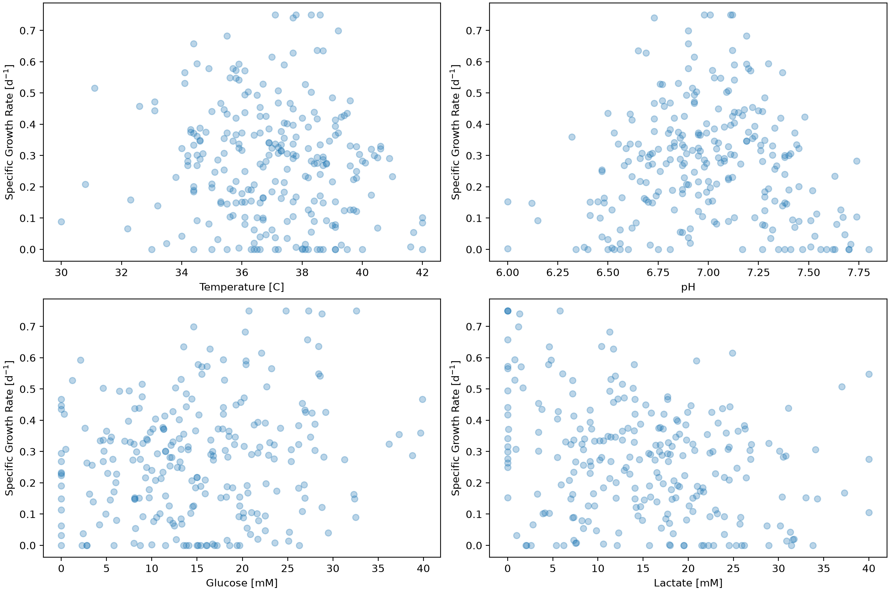
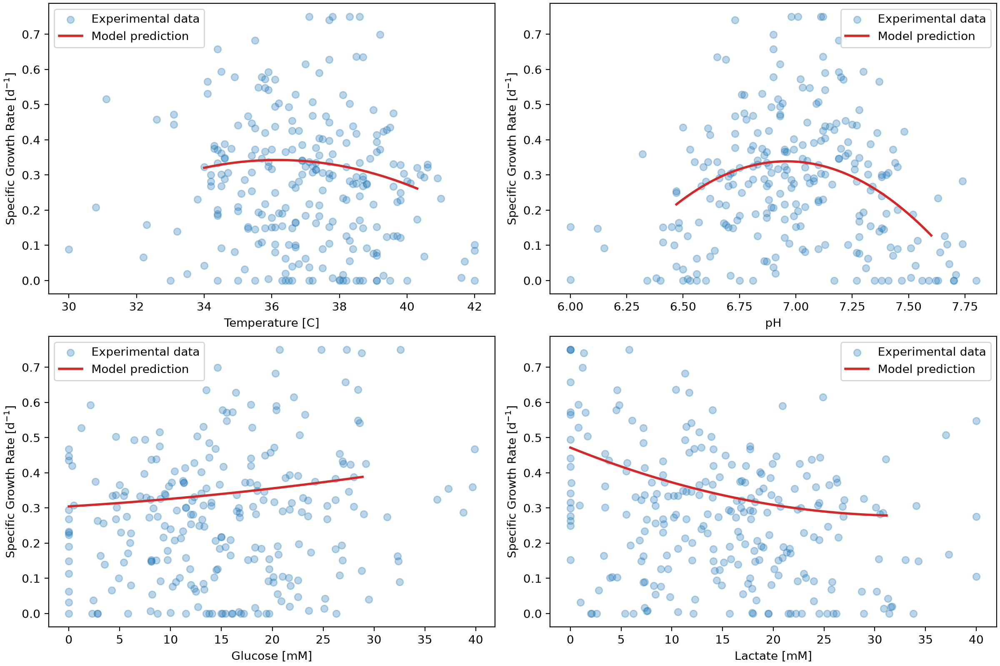
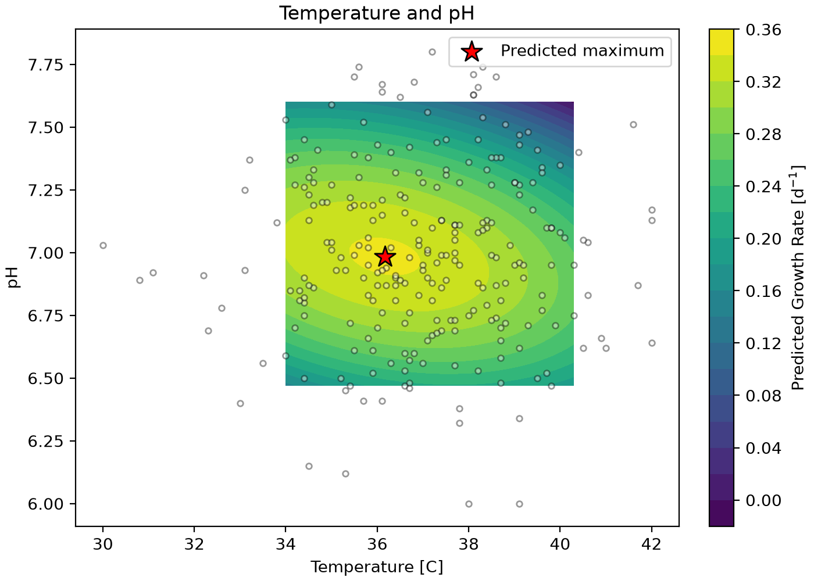
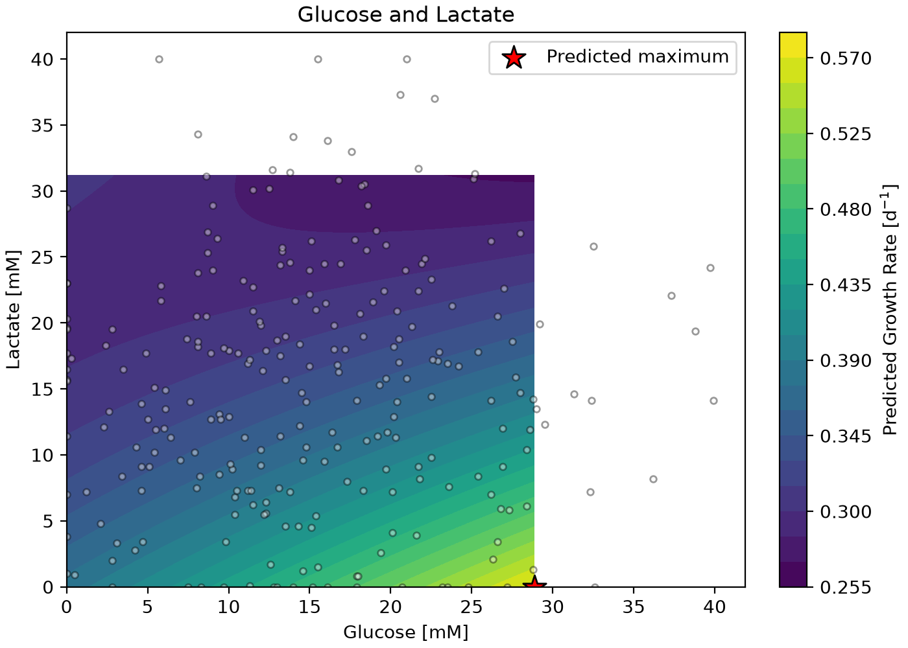

# Cell Growth Rate Prediction Using Machine Learning
This project develops a machine learning model to predict the specific growth rate of cell with a cell culture based on the temperature, pH, glucose concentration and lactate concentration. Linear regressions, polynomial regressions and k-nearest neigbours (KNN) regressions were evaluated to identify a suitable model. The model was selected based on predictive accuracy, complexity and intepretability. The model was used to investaige the effects of the oeprting conditions on cell growth including interations between variable and conditions associated with higher or lower growth rates.

## Highlights
- Developed a polynomial regression model for cell growth.
- Evaluated linear, polynomial and KNN regression performance.
- Selected second degree polynomial model using cross validation.
- Validated growth rate predictions using RMSE and R^2
- Investigated operating conditions using prediction and contour plots.

## Environment 
- Python 3.14.7
- NumPy 2.5.2
- Pandas 3.0.5
- Matplotlib 3.11.0
- scickit-learn 1.9.0

## Code Design
The program begins by calling the provided dataset, dataset_cell_growth_4factor.csv using pandas. The dataset contains 318 simulated data points. The first column is the specific growth rate, which is the target being predicted. The remaining four columns are temperature (°C), pH, glucose concentration (mM), and lactate concentration (mM). These features are extracted into a NumPy array so they can be used with scikit-learn's regression models. 
The data is split using train_test_split() with random state=0 where 80% is used for model training with the remaining 20% reserved for testing. The training data is used for model development, hyperparameter selection, and cross-validation. The test data are kept separate until the selected model is evaluated. This prevents the model being tested on data that was used in model generation.

The program first plots the training data against each input feature. These scatter plots provide an initial view of the dataset, but each plot only shows one feature at a time. Since growth rate depends on all four features, the scatter plots are used for exploration rather than as a complete description of the relationships.

Figure 1: Scatter plot's of input features in comparison to specific growth rate.

### Model Comparison and Selection
Polynomial regression models of degrees 1-3 are compared using StandardScaler, PolynomialFeatures, and LinearRegression in a pipeline. Degree 1 is the linear baseline, while degrees 2 and 3 allow the model to capture nonlinear trends and interactions between features. The models are evaluated using training and validation RMSE and R² from cross_validate(). The comparison results are saved to [`tables/model_comparison.csv`](tables/model_comparison.csv).

KNN regression is tested as an alternative model. Its pipeline combines StandardScaler with KNeighborsRegressor. GridSearchCV evaluates neighbor counts from 1 to 80 and both uniform and distance weighting, using five-fold cross-validation and RMSE to rank the combinations. The results are saved to [`tables/knn_grid_search.csv`](tables/knn_grid_search.csv).

The selected second degree polynomial and optimized KNN models are also compared using repeated five-fold cross-validation with five repetitions. This provides a check on how much their scores change when the training data are divided differently. The results are exported to [`tables/repeated_cross_validation.csv`](tables/repeated_cross_validation.csv).

### Final Polynomial Model
After model selection, the second degree polynomial is fitted to the full training set. Predictions are made for both the training and reserved test data, and RMSE and R² are calculated using root_mean_squared_error() and r2_score().

The polynomial terms are identified using model["polynomialfeatures"].powers_. Their fitted coefficients and the intercept are obtained from the linear-regression step and saved to [`tables/polynomial_coefficients.csv`](tables/polynomial_coefficients.csv). As scaling occurs before the polynomial transformation, the coefficients correspond to standardized features rather than the original measurement units.

### Operating Condition Plots
The fitted model is then used to examine the effect of each operating variable. For the individual prediction curves, one feature is varied between its 5th and 95th percentiles while the other three are held at their training-set medians. This allows the model's response to each variable to be examined under a consistent set of conditions.

Two contour plots examine temperature with pH, and glucose with lactate. For each plot, the other two features remain fixed at their median values. The model calculates predicted growth rates for a grid of operating conditions by standardizing the inputs and applying the fitted polynomial equation. The highest and lowest predicted growth rates within each grid are then identified. These results represent predictions under specific conditions rather than an overall optimum across all four variables.

All calculations, tables, and figures are generated by main.py.

## Analysis
### Comparison of Polynomial Models
The second degree polynomial produced the lowest validation RMSE among the reported polynomial models. The results from shuffled five-fold cross-validation are shown in the table below.

Table 1: Polynomial model cross-valdiation results.

|Model                                   |Train RMSE [d^-1]                               |Valid RMSE [d^-1]|Train R2|Valid R2|
|----------------------------------------|------------------------------------------------|-----------------|--------|--------|
|Polynomial degree 1                     |0.171                                           |0.177            |0.127   |0.043   |
|Polynomial degree 2                     |0.143                                           |0.155            |0.391   |0.272   |
|Polynomial degree 3                     |0.130                                           |0.168            |0.497   |0.135   |

The linear model had the highest validation error, with an RMSE of 0.177 d⁻¹ and an R² of 0.043. The second degree model reduced the validation RMSE to 0.155 d⁻¹ and increased R² to 0.272. This improvement suggests that the relationship between growth rate and the operating variables cannot be described adequately using only linear terms. 
Increasing to the 3rd degree improved the fit to the training data, reducing training RMSE from 0.143 to 0.130 d⁻¹. However, validation RMSE increased to 0.168 d⁻¹, and validation R² decreased to 0.135. The model became better at fitting the training observations without improving its predictions on the validation folds. This suggests overfitting, so the additional complexity of degree 3 was not justified.

The second degree model was selected because it gave the best balance between training fit, validation performance, and model complexity. It also produces an equation whose coefficients and interactions can be examined when interpreting the growth-rate response.

### KNN Optimization
The K-Nearest Neighbors method was tested and compared to the polynomial model.The grid search tested 160 combinations of neighbor count and weighting method. The best model used 18 neighbors with distance weighting, giving a mean validation RMSE of 0.162 d⁻¹. A table summarizing all KNN results is available under tables. As the top result used distance weighting, it suggests that performance was not particularly sensitive to choosing exactly 18 neighbors.
The optimized KNN model, using 18 neighbors and distance weighting, achieved a validation RMSE of 0.162 d⁻¹, compared to 0.155 d⁻¹ for the 2nd degree polynomial. Although both models performed similarly, the polynomial model had slightly better validation performance and allowed for easier interpretation of the relationships between operating conditions and cell growth. For these reasons, the 2nd degree polynomial was selected for further analysis.

### Final Testing Results
After fitting the selected model to the training set, its performance was evaluated on the 20% of samples held aside for testing.

Table 2: Summary of final testing results:

|Finding                                 |Value                                           |
|----------------------------------------|------------------------------------------------|
|Selected model                          |Polynomial regression (degree 2)                |
|Validation RMSE                         |0.155 d^-1                                      |
|Validation R^2                          |0.272                                           |
|Final test RMSE                         |0.157 d^-1                                      |
|Final test R^2                          |0.384                                           |
|Best temperature-pH region              |~36-37 C, pH ~7.0                               |
|Highest predicted glucose-lactate growth|0.590 d^-1 at 28.87 mM glucose, 0.00 mM lactate |
|Lowest predicted glucose-lactate growth |0.280 d^-1 at 28.87 mM glucose, 31.17 mM lactate|

The final test RMSE of 0.157 d⁻¹ was close to the cross-validation result of 0.155 d⁻¹. This suggests that the model maintained a similar level of prediction error on this unseen test set. The test R² of 0.384 indicates that the model explained approximately 38% of the variation in test growth rates. While it captured some useful patterns, a substantial amount of variation remained unexplained.

The fitted polynomial contains first-order, squared, and interaction terms for the four input features. The negative linear lactate coefficient (−0.060), negative pH-squared coefficient (−0.061), and positive linear glucose coefficient (+0.025) are among the larger terms. However, the coefficients apply to standardized inputs, and the effect of one variable also depends on the other terms in the equation. For that reason, the prediction curves and contour plots provide a clearer picture of the model's behaviour than individual coefficients alone.

### Effect of Individual Operating Conditions

Figure 2: Predicted effects of individual operating conditions on specific growth rate.*

The prediction curves show higher growth rates around 36–37°C and pH 7.0. Glucose has a relatively small positive effect, while increasing lactate produces a more noticeable decrease in predicted growth. These trends are based on the polynomial model with the remaining variables held at their median values.

### Effect of Temperature and pH

Figure 3: Contour plot of temperature and pH vs. predicted growth rate.

The temperature–pH contour plot shows the predicted growth rate when glucose and lactate are held at their median values. The highest predicted growth rate within the plotted range was 0.343 d⁻¹ at 36.16°C and pH 6.98. Growth generally decreased as the conditions moved away from this region.

The lowest predicted value on this grid was −0.005 d⁻¹ at 40.30°C and pH 7.60. The negative prediction appears near the edge of the plotted range, where polynomial models can sometimes produce less reliable results. Depending on how growth rate is defined, negative values may represent a decline in cell population, but the model alone cannot determine the underlying biological behaviour.

These results suggest that temperature and pH have a curved relationship with predicted growth rate. However, the favourable region identified here applies only to the glucose and lactate values held constant in the plot. It should not be treated as a confirmed optimum for the complete process.

### Effect of Glucose and Lactate

Figure 4: Contour plot of glucose and lactate vs. predicted growth rate.

The glucose–lactate plot shows a stronger decrease in predicted growth as lactate increases. With temperature and pH fixed at their median values, the model predicted a maximum of 0.576 d⁻¹ at 28.87 mM glucose and 0.00 mM lactate. At the same glucose concentration but with lactate increased to 31.17 mM, the predicted growth rate fell to 0.268 d⁻¹.

This difference of 0.308 d⁻¹ across the plotted lactate range suggests that lactate has a substantial influence on the model's predictions under these conditions. The trend is consistent with the negative linear lactate coefficient, although the model also includes squared and interaction terms that affect the overall response.

Both the maximum and minimum occurred at the highest glucose value included in the plot. Since the maximum lies on the boundary, this analysis does not identify an optimum glucose concentration within the tested range. The temperature–pH and glucose–lactate maxima also should not be compared directly, because different features are held constant in each plot.

### Model Limitations and Applications
The main limitation of this study is that the dataset is simulated rather than experimental. The model reflects the patterns in the supplied data, but these may not fully represent real cell-culture behaviour. Other factors, including dissolved oxygen, additional nutrients, cell type, and changes over time, are not included in the four model inputs. 

The moderate R² and validation error also mean that predicted differences should be interpreted with some caution. In addition, the contour plots vary two features at a time while holding the others constant. Some plotted combinations may be uncommon or absent in the original dataset, even though each individual feature value falls within its selected range. Predictions near these conditions may be less reliable.

The model is therefore more useful for identifying trends and promising conditions for further investigation than for directly setting process operating points. The temperature–pH and glucose–lactate plots could help narrow down conditions for additional simulations or experiments, but the predictions would need to be checked using measured growth data before being applied in practice.

Overall, the 2nd degree polynomial provided the best reported validation performance, with a final test RMSE of 0.157 d⁻¹. It offers a reasonable starting point for investigating how the four operating conditions relate to cell growth, while leaving room for improvement with additional data and features.

